<picture>
  <source media="(prefers-color-scheme: dark)" srcset="assets/header-dark.svg">
  
</picture>

I help companies and start-ups build products that work: full-stack apps, data pipelines and automation, plus fractional CTO work.
These days I mostly build tooling around AI coding agents.

[lev.engineer](https://lev.engineer) · [LinkedIn](https://www.linkedin.com/in/levgel/) · [Medium](https://medium.lev.engineer/) · [hi@lev.engineer](mailto:hi@lev.engineer) · [Book a 30-min call](https://calendly.com/lev-/30min)

### Things I've shipped

| Project | What it does | |
|---|---|---|
| [gmail-tester](https://github.com/levz0r/gmail-tester) | Node.js Gmail client for checking that emails arrive in e2e tests |   |
| [html-to-markdown-mcp](https://github.com/levz0r/html-to-markdown-mcp) | MCP server that fetches pages and turns them into clean Markdown |   |
| [markdown-printer](https://github.com/levz0r/markdown-printer) | Browser extension that saves web pages as Markdown |  |
| [awesome-vibecoded-apps](https://github.com/levz0r/awesome-vibecoded-apps) | Curated, link-checked list of real apps built with vibe coding · [vibecodedapps.dev](https://vibecodedapps.dev) |  |
| [claude-code-statusline](https://github.com/levz0r/claude-code-statusline) | Claude Code statusline showing live tokens, cost and git state |  |

### Book

**[Web Testing with Cypress](https://lev.engineer/projects/web-testing-with-cypress-book)** (BPB, 2022): end-to-end testing for any web app, browser or platform.

### Latest writing

<!-- BLOG-POST-LIST:START -->- [Generating Dynamic AI-Powered FAQ Section for Sanity Blog Posts](https://blog.stackademic.com/generating-dynamic-ai-powered-faq-section-for-sanity-blog-posts-2a162ae4c998?source=rss-cd0db8c9eb2b------2) Jul 2025
- [JSR: The JavaScript Package Registry We’ve Been Waiting For](https://levelup.gitconnected.com/jsr-the-javascript-package-registry-weve-been-waiting-for-bfc00f7d9779?source=rss-cd0db8c9eb2b------2) May 2024
- [Scalable Web Scraping with Serverless — Part 2](https://levelup.gitconnected.com/scalable-web-scraping-with-serverless-part-2-523c4b1f3391?source=rss-cd0db8c9eb2b------2) May 2024
- [Scalable Web Scraping with Serverless — Part 1](https://levelup.gitconnected.com/scalable-web-scraping-with-serverless-part-1-34f7fc28ad1b?source=rss-cd0db8c9eb2b------2) Apr 2024
- [Web Scraping Like a Pro: Unlocking the Power of Impersonation](https://blog.stackademic.com/web-scraping-like-a-pro-unlocking-the-power-of-impersonation-296477955991?source=rss-cd0db8c9eb2b------2) Apr 2024
<!-- BLOG-POST-LIST:END -->

The post list updates daily from Medium via a GitHub Action.
